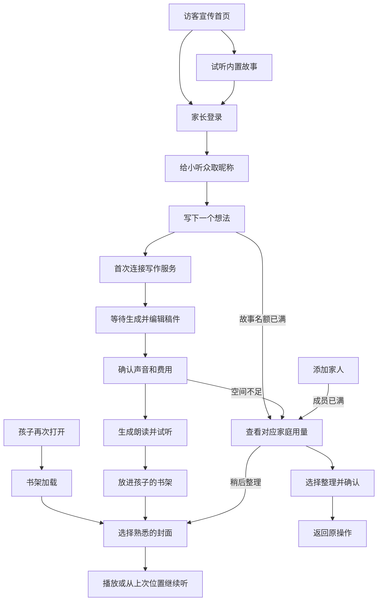

# 家庭有声故事平台 · 产品与技术方案

平台定位为**家庭私有的有声故事书架**。家长用自己的模型服务创作、编辑和配音，孩子在独立的听故事空间里挑选、收听和收藏。一篇故事可以长期保存，可以由另一位家长接着讲，也可以成为一个系列的下一集。

家长可能每周创作一两次，孩子可能连续七晚听同一个故事。因此，已登录家庭的孩子打开书架先看到「继续听」和熟悉的封面；家长进入创作台，才看到故事草稿、配音和模型设置。Provider、Model 和 API Key（SK）配置一次，之后作为家庭偏好自动复用。

## 设计起点：先走通概念交互图

打开[可点击的网页概念交互图](interaction-map.html)，从家长、孩子和遇到额度限制的家长三个角度走一遍。左侧可直接选择页面，右侧按钮演示真实操作的先后顺序。所有示意数据仅用于评审。

正式设计页面前，先确认三个问题：家长第一次创作时是否知道下一步该点哪里、孩子是否能自己找到上次的故事、额度提示能否带家长回到刚才的任务。调整入口、步骤或权限时，先更新图，再据此细化页面和开发任务。

### 开发与评审顺序

概念图确定后，先交付可通过 Tailscale 访问的完整前端交互，使用本地数据和示例服务走查家庭使用场景。家长与孩子的操作、异常提示、视觉和播放体验经确认后，再开发 Workers、D1、R2、Queues 及真实服务商调用。前端运行与测试方式见[项目说明](../README.md)。

## 一、家庭、成员与权限

以**家庭**作为数据和权限边界。一个成人账户可以创建家庭、邀请另一位照护者，并为多个孩子建立独立档案。儿童档案只需昵称、头像和可选年龄段，每个孩子有自己的书架、收藏和播放进度。

| 身份 | 可以做什么 |
|---|---|
| 家庭管理员 | 邀请和移除成人成员，配置家庭可用的模型服务和用量限额，管理儿童档案，导出或删除家庭数据 |
| 成人创作者 | 创作和编辑故事，使用被授权的服务配音，决定发布给哪些孩子，也可以撤回已发布的故事 |
| 儿童听众 | 在自己的书架选故事、播放、收藏。共用平板上切回家长区时，需要家长解锁 |

允许另一位家长使用一把 Key，会动用这把 Key 对应账户的余额。保存凭据时由持有人明确选择「仅自己使用」或「授权家庭成人使用」。其他成员只能调用已授权配置。保存后界面仅显示掩码，由持有人管理凭据；更换服务地址时需重新输入 Key。成员离开家庭时，同时解除其凭据授权。

### 每个家庭的共享额度

| 上限 | 计数规则 | 达到上限时 |
|---|---|---|
| 100 个故事 | 每个独立作品占一格，含草稿和归档作品。续集是新作品；同一作品的改稿和录音共用一格。 | 提示「书架已放满 100 个故事」，提供「整理书架」。已有故事仍可编辑和播放。 |
| 20 人 | 管理员、其他成人和儿童档案合计；同一人使用多台设备只计一次。待接受邀请在加入时检查名额。 | 停止新增档案或加入成员，提示家长前往「家人」查看。 |
| 100 MB 内容 | 以 100,000,000 字节计。累计家庭保存的所有内容，包括文字及各版稿件、各版录音、上传图片和头像；家庭内共用同一份文件只计一次。平台内置素材由平台承担。 | 写入会超额时保留当前输入，提示「空间快装满了」，显示剩余空间和「整理空间」。可先导出，再选择删除旧录音或其他内容。 |

家长在「我的家庭」可见三项用量，如「故事 18/100 · 家人 4/20 · 空间 37/100 MB」。只有相关操作接近或触及上限时才出现就地提示。删除旧录音只释放相应空间，删除整篇作品才腾出故事名额；归档仍占用额度。

## 二、一篇故事从创作到反复收听

### 第一次使用

访客先看宣传首页，了解用途、试听三篇公共绘本，点击「开启家庭书架」才进入家长登录。登录前不显示家庭成员、收藏、作品或新手引导。

首次登录后，小狐狸按实际操作逐步引导：给小听众取昵称 → 写一个想法 → 审稿并配音 → 发布给孩子 → 点开自己刚发布的故事。每一步显示进度和当前动作，稿件与步骤分别保存。可以跳过、继续未完成的步骤，或在「我的家庭」重新体验。

### 日常创作与收听

以“给怕黑的孩子讲一篇小狐狸露营的故事”为例。

1. **创作。** 默认选中上次使用的儿童档案；家长只需输入一句想法，点「写故事」。系统带入这个孩子的语言、年龄段、偏好时长和默认音色。主题、角色、希望避开的内容按需展开。家长也可以直接贴入自己写好的故事，进入配音。
2. **审稿。** 生成结果按段落展示，家长可以改标题、亲自改写、选中一段让模型重写，或恢复上一版。例如把“森林里传来可怕的叫声”改成“小狐狸听见树叶沙沙响”，其余段落保留。草稿自动保存。
3. **配音。** 默认沿用家庭喜欢的声音。家长想换声音时，可以用正文中的一句试听，再确认生成全文。开始前显示服务商、模型、待合成字数；有可靠费率时再显示费用估算。生成在后台继续，家长离开页面也能回来查看。
4. **发布。** 家长听过成品后，点「放进书架」即可发布给当前选中的孩子。系统提供默认封面，也可展开选项，更换封面、加入系列或分享给家里其他孩子。儿童书架只展示已发布版本。之后修改稿件时，旧版仍可继续听，直到家长确认替换。
5. **收听。** 孩子点封面播放，在手机上听到一半，晚上换平板可以继续。单篇故事默认播完即停；系列连播、定时关闭由家长设置。播放失败时保留当前位置。
6. **续写。** 家长从书架点「写下一集」，沿用角色设定、世界背景和前情摘要。新一集有自己的稿件和音频，孩子能按顺序听，也能直接重播最喜欢的一集。

**稿件、录音和发布版本各自独立。** 同一篇故事可以有普通话版和英语版，也可以保留孩子最喜欢的旧音色。改一个标题无需重新付费配音，试一个新声音也不会覆盖原来的录音。

## 三、页面与视觉设计

孩子从「我的书架」进入，家长区只保留「写故事」「我的书架」「我的家庭」三个入口。下表中的编辑、播放、服务配置均从对应任务进入。每屏突出一个下一步，版本管理、模型参数和用量明细按需展开。

| 页面 | 核心任务与设计重点 |
|---|---|
| 访客首页 | 用原创绘本和可播放的声音来信介绍产品，提供试听与家长登录。 |
| 儿童首页 | 首屏放「继续听」，其次是「我喜欢的」和系列书架。卡片用稳定的封面、角色和简短标题帮助孩子认故事。兄弟姐妹能看出当前选中的是谁的档案。 |
| 故事播放器 | 大封面、一个醒目的播放键、进度条、前后跳转和睡眠定时。支持锁屏控制，回到书架时用迷你播放器继续播放。睡前模式降低亮度，关闭持续动画。 |
| 家长创作台 | 首屏突出「写故事」，有未完成草稿时提供「接着写」。导入已有故事放在创作页的次级入口。进入作品后，正文、版本和录音围绕同一篇故事组织，家长随时知道下一步可以做什么。 |
| 家庭内容库 | 按孩子、系列、主题和发布状态筛选。每篇作品显示谁可以听、当前发布的录音、是否有未发布修改。支持收藏、归档、导出和删除。 |
| 模型与声音 | 分为「写故事」和「讲故事」两项能力。每项支持多个配置，包括 Provider、服务地址、Model、API Key 和默认参数；分别测试文字生成与声音试听。一个服务商可以承担两项能力。 |
| 家庭设置 | 管理成员、儿童偏好、家长锁、授权凭据和用量。按月查看文字生成次数、配音字数、音频占用空间，并能定位到具体作品。 |

界面图标统一由原创 SVG 绘制，包含导航、播放器、状态反馈和输入密钥时双爪捂眼的小狐狸。播放器采用绘本小剧场与收音机式大按钮，提供带文字的辅助功能。采用绘本式视觉。白天用奶油底色、手绘动物和圆角书封，睡前切换成深蓝夜色。同一系列固定主角与封面构图，用不同颜色和集数区分故事。播放、暂停等控件保持熟悉的形状，文字与背景保持足够对比度。家长区延续同一套配色，为长文编辑、服务配置和错误提示留出清晰空间。

### 全站下拉选择

服务商、模型、声音、语言等凡是采用下拉交互的字段，桌面端和移动端统一使用自绘的绘本风选择器，禁止使用浏览器或操作系统的默认 select 菜单。收起时显示字段名、当前值和手绘折角，展开时用奶油色圆角纸签列出选项，配小插画和清晰文字。勾号标记已选项，键盘高亮独立显示；图案仅作辅助。

点击或轻触选项即确认，点外部或按 Esc 收起并保留原值。键盘可用方向键浏览、Enter 或空格确认、Tab 前往下一字段。读屏可获知字段名、展开状态、选项和当前选择。原本可直接点按的封面和场景按钮维持直接操作。

### 等待时看到什么

| 场景 | 界面反馈 |
|---|---|
| 首次加载书架、故事详情或播放器 | 按真实布局展示封面、标题和播放键的骨架屏。数据到达后原位替换。返回已打开的书架时保留现有封面，只在更新处显示小狐狸翻页的轻动画。 |
| 写故事、合成声音 | 分别用手绘小狐狸写字、戴耳机的短循环动画，搭配「正在写故事」「正在准备朗读」。只有拿到真实进度时才显示数字。等待较久可离开，回来能继续查看。 |
| 验证服务、提交按钮等待响应 | 按钮内显示小爪印加载动画和「正在连接」等文字，避免重复提交。失败时停止动画，说明原因并提供重试入口。 |
| 空书架、加载失败 | 成功加载且为空时用手绘空书架引导创作；网络失败时显示「重新加载」，保留已加载的内容。 |

手绘素材优先用于封面、首次引导和能解释当前动作的位置。动效安静、短小；睡前模式或系统开启「减少动态效果」时改用静态插画和文字状态。骨架屏只作占位，辅助技术读取实际加载状态。

### 输入密码和密钥

密码、家长口令和 API Key 默认遮蔽。输入框获得焦点时，附近带眼睛的小狐狸插画用爪子捂眼，直至输入结束；显隐按钮也采用「捂眼／睁眼」图标，并提供「显示密钥／隐藏密钥」等可读标签。只有用户主动选择显示，字段才显示当前输入的内容；离开输入框与显隐按钮所在区域后恢复遮蔽。减少动态效果时使用静态捂眼图。已保存的 Key 显示掩码和「更换密钥」入口。

## 四、模型、内容与费用规则

配音体验、选声与盲听验收见[故事声音产品设计](voice-product.md)。服务商适配、合成任务、分段、持久化与播放接口见[语音合成技术设计](voice-architecture.md)。

- **服务兼容性。** 将 Provider 设计成可扩展的适配器，分别声明文字生成、语音合成、可选音色、字数限制和输出格式。用户可以手填 Model。保存时分别验证地址、凭据、模型权限和实际能力，错误提示应能区分「Key 已失效」「模型不可用」「余额不足」。
- **家长掌握内容。** 创作时采用孩子的年龄段和家庭避讳主题；发布前由成人确认。向模型发送完成任务所需的最少信息，例如年龄段和虚构角色名。文字服务会收到创作提示，语音服务会收到确认后的正文，设置页应说明各自的数据去向。
- **付费动作可预期。** 家长可以为每个配置设置每日生成次数、单篇字数和每月配音字数上限。生成前检查，重复点击复用同一任务。服务商超时且扣费状态不明时，保留稿件和任务记录，让家长决定是否再试。已有录音可反复播放。
- **家庭资产可带走。** 支持导出故事文本和音频。删除 Key 后，历史故事继续可听；撤回故事后，儿童端立即失去访问权限；删除作品时清理对应录音，并在操作前列明影响。即使某家 Provider 停服，已经做好的家庭书架仍然可用。

## 五、适配 Workers 和 D1 的技术架构

| 组件 | 职责 |
|---|---|
| 前端与 Workers Static Assets | 承载儿童书架、播放器和家长工作台。移动端优先，桌面端提供更宽的编辑视图。 |
| Workers API | 登录会话、家庭权限、模型适配、凭据加解密、用量校验和音频播放鉴权。用户 Key 用带版本的主密钥加密后存储，主密钥由 Worker Secret 管理。 |
| D1 | 保存家庭、成员、儿童档案、服务配置、故事、稿件版本、录音元数据、发布记录、任务、用量和播放进度。播放进度关联「儿童档案 + 录音」，同一家庭的孩子可以分别续听。 |
| R2 私有存储 | 保存音频及用户上传的封面。音频通过鉴权接口按范围读取，支持拖动和断点续播。每份已发布录音有稳定的对象标识。 |
| Queues | 执行文本生成、长文分段配音和失败恢复。任务持久状态保存在 D1；队列只传任务标识。长故事按段落合成并记录完成状态，某段失败时可以只补该段。 |

数据库分别建模 `Story`（作品）、`Revision`（稿件）、`Recording`（录音）和 `Publication`（哪些孩子能听哪个版本）。这四个对象共同支持改稿、换音色、撤回、续播和家庭权限。

**成本策略。** 平台承担有上限的托管资源，模型费用由凭据持有人承担。Cloudflare 免费额度可以覆盖一定规模的使用，音频长期积累后仍可能产生存储费用。全站容量与家庭额度分别控制。按 5 分钟、64 kbps 估算，一份录音约 2.4 MB；40 份约 96 MB，还需给文字、图片等留出空间。因此一个家庭可能先用完空间，也可能先达到故事数量上限。[Workers 限制](https://developers.cloudflare.com/workers/platform/limits/) · [D1 定价](https://developers.cloudflare.com/d1/platform/pricing/) · [R2 定价](https://developers.cloudflare.com/r2/pricing/) · [Queues 定价](https://developers.cloudflare.com/queues/platform/pricing/)

**额度执行。** Worker 在创建作品、接受邀请、添加儿童、上传及生成内容前，通过 D1 原子条件写入检查并预留相应名额或字节。流式生成使用有界预留，输出将超出预留时须先申请追加空间。成功后按实际字节结算，失败、取消或超时后清理临时文件并释放预留；重复请求按同一任务结算一次。删除后核减实际释放的用量。已有内容的读取和播放无需新增额度。

## 六、正式上线的验收标准

1. 家长能独立配置文字和语音服务，分辨哪一步会消耗谁的额度，并完成创作、修改、配音和发布。
2. 孩子在共用设备上只能看到授权给自己的故事，无法进入凭据设置或发起付费生成。
3. 关掉页面、网络中断、重复点击、某段配音失败后，作品仍能找回，任务状态可解释，已完成段落可以复用。
4. 家长修改草稿、撤销 Key 或更换 Provider 后，孩子仍能正常收听原有的已发布录音。
5. 手机锁屏播放、拖动进度、跨设备续播、播完即停，以及家庭内容导出和删除，均通过真实设备验收。
6. 测试家庭分别达到 100 个故事、20 人、100 MB 的边界，并测试并发加入或生成。达到上限时已有内容可读可播，超额操作有明确提示，释放相应名额或空间后可继续。
7. 在慢网、空数据和请求失败三种条件下检查书架、详情、播放器与创作页。骨架屏能正确结束，错误可重试，启用减少动态效果后仍能读懂状态。
8. 使用触屏和键盘检查密码、家长口令与密钥输入：默认遮蔽、聚焦时捂眼、显隐可控、离开后恢复遮蔽。
9. 首次使用的家长可在默认设置下走完「登录 → 设置听众 → 写故事 → 审稿配音 → 发布并播放」，可跳过、退出续接和重新打开引导；儿童可直接点封面播放。
10. 桌面和手机的所有下拉均呈现绘本风选项面板。使用触屏、键盘和读屏验证展开、选中、取消与离开，返回页面仍能看到本次已选值。

上线后的首要指标是**每周有孩子实际收听已发布故事的家庭数**。同时观察首次发布成功率、配音失败率和七日重播率，分别评估家长能否完成创作、录音能否可靠生成，以及孩子是否愿意回来听。
